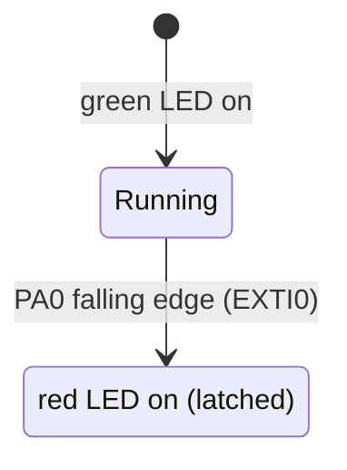

# EXTI Emergency Stop (E-Stop)


-orange)


An emergency-stop input handled by an **external interrupt** on an STM32F407 Discovery board, built on a small **reusable EXTI driver** written at register level (CMSIS only, no HAL). The CPU sleeps with `WFI` until an event; when the normally-closed E-stop circuit opens, the interrupt sets a flag and the main loop switches from the green "running" LED to the red "stopped" LED.

## Features

- **Reusable EXTI driver** (`exti_driver.c/.h`): one config struct selects port (A–D), pin and edge (rising / falling / both); the driver enables the GPIO clock, sets the pull-down, maps the line in `SYSCFG->EXTICR`, sets the trigger and enables the NVIC line (EXTI0–EXTI4)
- **Short ISR**: clears the pending bit and only sets a flag; the LED change happens in the main loop
- **Low-power idle**: `WFI` between events, with `DBGMCU` set so the debugger stays connected in sleep
- **Latched stop state**: once triggered, the red LED stays on until reset

## Hardware

| Part | Notes |
|---|---|
| STM32F407G-DISC1 | Default 16 MHz HSI clock; on-board LEDs used |
| Normally-closed E-stop switch | Between 3.3 V and PA0 |

### Wiring

| Signal | STM32 pin | Connects to |
|---|---|---|
| EXTI0 (input, pull-down, falling edge) | PA0 | NC E-stop switch to 3.3 V |
| Green LED (running) | PD12 | On-board |
| Red LED (stopped) | PD14 | On-board |

With the switch closed, PA0 is high; pressing the E-stop opens the circuit, the pull-down pulls PA0 low and the falling edge fires the interrupt. (The Discovery board's blue USER button is also on PA0 but is normally open, so with it the interrupt fires on release.)



## Driver usage

```c
EXTI_Config_t cfg = {
    .port = EXTI_PORT_A,
    .pin  = 0,
    .edge = EXTI_EDGE_FALLING,
};
EXTI_Init(&cfg);   // then implement EXTIx_IRQHandler for the line
```

## Build and flash

Requires the [Arm GNU Toolchain](https://developer.arm.com/downloads/-/arm-gnu-toolchain-downloads) (`arm-none-eabi-gcc`) and GNU Make.

```bash
make            # -> build/EXTI_EStop_Button.elf / .bin
make flash      # uses st-flash (stlink tools)
```

## Known limitations

- The driver enables NVIC only for EXTI lines 0–4 (pins 0–4); pins 5–15 use shared vectors that are not handled.
- The `callback` field of `EXTI_Config_t` is stored in the config but not called by the driver; the application's ISR calls it directly.
- No debounce; a mechanical switch can produce several edges (harmless here because the stop state is latched).

---

### 🇹🇷 Türkçe özet

STM32F407 Discovery üzerinde, HAL kullanmadan register düzeyinde yazılmış **acil durdurma (E-stop)** uygulaması ve **yeniden kullanılabilir EXTI sürücüsü**. Sürücü tek bir yapı ile port, pin ve kenar seçimini yapıp GPIO, SYSCFG, EXTI ve NVIC ayarlarını kuruyor. İşlemci `WFI` ile uyuyor; normalde kapalı E-stop devresi açıldığında PA0'daki düşen kenar kesmesi bayrak kuruyor, ana döngü yeşil LED'i (PD12) söndürüp kırmızı LED'i (PD14) yakıyor.
